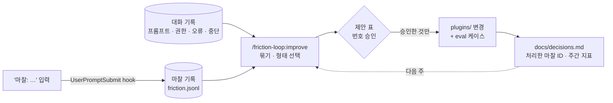

# plugin-playground

Claude Code 플러그인 모음이다. 중심인 friction-loop는 Claude Code를 쓰다 불편했던 순간을 한 줄로 남기면, 일주일에 한 번 그 기록을 묶어 Claude Code 확장(Claude의 동작을 바꾸는 skill, hook 같은 구성 요소)을 만들거나 고치자고 제안한다. 승인한 제안만 반영되므로, 쓸수록 내 작업 방식에 맞춰진다.

| 플러그인 | 버전 | 하는 일 |
|---|---|---|
| [`friction-loop`](plugins/friction-loop/README.md) | 0.2.2 | 불편한 순간을 한 줄로 기록하고, 주간 검토로 확장을 만들고 고치고 지운다 |
| [`writing-for-human`](plugins/writing-for-human/README.md) (선택) | 0.1.0 | Claude가 README, PR 설명, 커밋 메시지처럼 사람이 읽을 글을 쓸 때 독자부터 정하고, 대화 맥락 없이 초안만 읽는 보조 Claude에게 시험해 고치게 한다 |

friction-loop는 이렇게 쓴다.

1. 불편한 순간에 `마찰: <무엇이 불편했나>`를 입력한다. hook(정해진 순간에 Claude Code가 자동으로 실행하는 명령)이 기록만 하고 Claude에게는 보내지 않으므로 토큰이 들지 않는다.
2. 일주일에 한 번 `/friction-loop:improve`를 실행한다. 마찰 기록과 최근 대화 기록을 묶어 개선안을 표로 보여 준다.
3. 반영할 번호를 고른다. 고른 것만 이 저장소를 포크한 내 사본의 `plugins/` 폴더(friction-loop 같은 기존 플러그인이나 새 플러그인)에 반영된다. 같은 문제를 다시 잡아낼 eval 케이스(실제 모델에 같은 상황을 시켜 보고 채점하는 시험)와 결정 기록(`docs/decisions.md`, 무엇을 왜 바꿨는지 적는 파일)도 함께 남는다. eval 실행과 커밋은 직접 한다.

주간 검토는 플러그인 파일을 직접 고치므로, 이 저장소를 포크한 내 사본에서만 돈다. 그래서 시작하는 길이 둘이다.

- **기록부터 써 보기:** 아래 명령으로 원본을 설치하고 [빠른 시작 1단계](#1-첫-마찰-기록하기)로 확인한다. 주간 검토를 쓸 때가 되면 내 사본으로 갈아타고, 그동안의 기록을 옮긴다.
- **처음부터 주간 검토까지:** 아래 명령은 건너뛰고 [빠른 시작 2단계](#2-내-사본에서-주간-검토-돌리기)로 바로 간다.

이 저장소는 `aumilkyeong`이라는 이름의 마켓플레이스(설치할 수 있는 플러그인 목록)다. 그래서 먼저 마켓플레이스로 등록하고, 플러그인 이름 뒤에 `@aumilkyeong`을 붙여 설치한다.

```bash
claude plugin marketplace add aumilkyeong/plugin-playground   # 처음 한 번
claude plugin install friction-loop@aumilkyeong
claude plugin install writing-for-human@aumilkyeong           # 선택
```

**상태 (2026-11-15):** 시작 단계다. 실제 세션에서 마찰을 기록하거나 주간 검토를 돌려 본 적은 아직 없고, 스크립트 실행과 eval로만 확인했다([알려진 제약](#알려진-제약)). Claude Code 2.1.311, Python 3.9.6에서 확인했다.

## 빠른 시작

필요한 것: Claude Code(2.1.311에서 확인), Python 3.9 이상, macOS 또는 Linux. 기록 스크립트가 파일 잠금에 `fcntl`(Windows에 없는 Python 모듈)을 쓰므로 네이티브 Windows에서는 돌지 않는다.

### 1. 첫 마찰 기록하기

설치한 뒤 어느 프로젝트에서든 Claude Code 세션을 열고 `마찰: 테스트`를 입력한다. `마찰 F-001 기록 · 누적 1건 · 검토는 /friction-loop:improve`가 담긴 메시지가 보이면 된다. 이 메시지는 Claude에게 전달되지 않는다. `마찰:` 대신 `friction:`으로 시작해도 된다.

시험 삼아 남긴 기록도 주간 검토에 올라온다. 검토 표에서 고르지 않으면 아무것도 반영되지 않으니 그대로 둬도 된다.

### 2. 내 사본에서 주간 검토 돌리기

`/friction-loop:improve`는 확장이 담긴 저장소의 `plugins/` 폴더를 고치면서 시스템을 키운다. 그래서 고칠 수 있는 내 사본이 있어야 하고, 사본이 아닌 폴더에서 부르면 아무것도 하지 않고 사본으로 옮기라고 안내한다.

1. GitHub에서 이 저장소를 포크(내 계정으로 복사)하고 내려받는다.

   ```bash
   git clone https://github.com/<내 계정>/plugin-playground.git
   cd plugin-playground
   ```

2. 내 사본의 두 파일을 고친다.
   - `.claude-plugin/marketplace.json`의 `"name"` 값을 내 이름(예: GitHub 계정)으로 바꾼다. 이 값이 마켓플레이스 이름이 되어 원본 `aumilkyeong`과 구별된다.
   - 결정 기록 `docs/decisions.md`를 지운다. 이 파일은 원작자의 이력(주간 지표와 변경 기록)이고, 검토는 여기 적힌 마찰 ID(`F-001` 꼴)를 처리된 것으로 본다. 그대로 두면 원작자의 `F-001` 때문에 내 `F-001`이 검토에서 빠진다. 지워 두면 첫 주간 검토가 빈 결정 기록을 새로 만든다.
3. 내 사본을 마켓플레이스로 등록하고 설치한다.

   ```bash
   claude plugin marketplace add "$PWD"
   claude plugin install friction-loop@<내 이름>
   ```

   로컬 폴더로 등록한 마켓플레이스의 플러그인은 다른 곳으로 복사되지 않고 이 폴더에서 바로 로드된다. 그래서 사본을 고친 뒤에는 세션에서 `/reload-plugins`만 실행하면 반영된다.

4. 원본을 설치했다면 지운다. 같은 이름의 플러그인이 둘이 되기 때문이다. 원본을 설치하지 않았다면 건너뛴다.
   - 그동안의 마찰 기록을 버려도 되면 `claude plugin uninstall friction-loop@aumilkyeong`만 실행한다.
   - 기록을 옮기려면 데이터를 남긴 채 지우고, 기록 파일을 새 설치본의 데이터 폴더로 복사한다.

     ```bash
     claude plugin uninstall friction-loop@aumilkyeong --keep-data
     mkdir -p ~/.claude/plugins/data/friction-loop-<내 이름>
     cp ~/.claude/plugins/data/friction-loop-aumilkyeong/friction.jsonl ~/.claude/plugins/data/friction-loop-<내 이름>/
     ```

5. 일주일쯤 마찰을 모은 뒤, 사본 폴더에서 Claude Code를 열고 실행한다.

   ```text
   /friction-loop:improve        # 최근 7일
   /friction-loop:improve 14     # 최근 14일
   ```

검토는 파일을 고치고 정적 검증(`claude plugin validate`)까지만 한다. eval 실행과 커밋은 하지 않는다. 바뀐 내용을 확인하고 직접 커밋한다. 원본에 새 변경이 생기면 GitHub 포크 페이지의 Sync fork로 받은 뒤 사본 폴더에서 `git pull`을 실행한다. 이때 `docs/decisions.md`가 부딪히면 내 쪽을 남긴다. 원작자의 이력은 내 사본에 필요 없다. 다른 파일이 부딪히면 직접 합친다.

writing-for-human은 원본 설치본을 그대로 써도 된다. 그 플러그인의 글쓰기 기준 목록(`standards.md`, 사용자에게 지적받은 글쓰기 실패와 해법)도 주간 검토로 내게 맞춰 키우려면, friction-loop처럼 원본을 지우고 내 사본에서 다시 설치한다.

### 3. 새 버전 받기

원본(`@aumilkyeong`)을 설치했다면 새 버전을 직접 받아야 한다. `aumilkyeong`은 Anthropic 공식 마켓플레이스가 아니어서 자동 업데이트가 기본으로 꺼져 있다.

- **그때그때 받기:** 플러그인마다 실행한다.

  ```bash
  claude plugin update friction-loop@aumilkyeong
  claude plugin update writing-for-human@aumilkyeong
  ```

- **자동으로 받기:** Claude Code 세션에서 `/plugin`을 열고, Marketplaces 탭에서 `aumilkyeong`을 골라 Enable auto-update를 누른다. 그러면 세션을 시작할 때마다 새 버전을 받는다.

어느 쪽이든 받은 버전은 `/reload-plugins`를 실행하거나 새 세션을 열어야 적용된다.

자동 업데이트를 켜기 전에 알아 둘 점이 있다. friction-loop의 hook은 프롬프트마다 샌드박스 밖에서 사용자 권한으로 돈다. 자동 업데이트를 켜면 원작자가 앞으로 바꾸는 내용을 검토 없이 그 권한으로 실행하게 된다.

내 사본을 로컬 폴더로 설치했다면 자동 업데이트와 상관없다. 플러그인이 사본 폴더에서 바로 로드되기 때문이다. 원본의 새 변경은 2단계 끝의 Sync fork로 받는다.

## 작동 방식

마찰은 사용자가 직접 남긴 기록과 대화 기록에 남은 신호, 두 길로 모인다. 주간 검토는 둘을 함께 묶어 제안하고, 승인한 결과를 결정 기록에 남겨 다음 검토의 입력으로 삼는다.



| 단계 | 하는 일 | 담당 |
|---|---|---|
| 포착 | `마찰:`로 시작하는 프롬프트를 기록하고, Claude에게 가지 않게 막는다 | `hooks/hooks.json`, `scripts/friction.py` |
| 수집 | 열린 마찰, 최근 N일 직접 입력한 프롬프트, 사용자가 말하지 않은 신호를 모은다. 신호는 직접 답한 권한 확인(Claude Code가 명령 실행을 물어 와 사용자가 직접 허락한 것), 권한 거절, 도구 오류, 중단이다 | `scripts/friction.py`, `scripts/recent_prompts.py`, `scripts/recent_signals.py` |
| 제안 | 원인이 같은 것끼리 묶고, 처리 하나와 담을 형태를 고른다 | `skills/improve/SKILL.md`, `skills/improve/references/forms.md` |
| 반영 | 승인한 번호만 `plugins/`에 반영하고 eval 케이스를 더한다 | `/friction-loop:improve` |
| 기록 | 처리한 마찰 ID와 주간 지표를 남긴다. ID가 적힌 마찰은 다음 검토에서 빠진다 | `docs/decisions.md` |

담당 파일은 `docs/decisions.md`를 빼고 모두 `plugins/friction-loop/` 아래에 있다.

시스템이 나아지는지는 **반복 지시**(북극성 지표)로 잰다. 여러 세션에서 되풀이한 같은 지시를 하나로 묶고, 그런 묶음이 몇 개인지 센다. 이 수가 줄어들수록 시스템이 나아지고 있다는 뜻이다.

제안 표의 처리와 형태는 이렇게 읽는다.

- **처리:** 만들기(담을 확장이 아직 없다), 고치기(확장이 발동하지 않거나 결과가 틀린다), 승격(지침만으로는 지켜지지 않아 더 강한 형태로 옮긴다), 지우기(쓰이지 않거나 다른 확장과 겹친다) 가운데 하나다.
- **형태:** CLAUDE.md(매 세션 Claude가 읽는 지침), rule(특정 경로의 파일을 다룰 때만 읽는 규칙), skill(Claude가 필요할 때 꺼내 읽는 작업 지침), hook(정해진 순간에 반드시 실행되는 명령) 등이다. CLAUDE.md → rule·skill → hook 순으로 강하고, 판단이 갈리면 약한 형태부터 쓴다. 이 밖에 agent(맥락을 따로 둔 보조 Claude), 스크립트, MCP 서버(외부 시스템 연결)도 있다. 형태마다 언제 쓰는지는 [형태 선택 기준](plugins/friction-loop/skills/improve/references/forms.md)에 있다.

## 데이터와 개인정보

| 데이터 | 위치 | 다루는 방식 |
|---|---|---|
| 마찰 기록 | `~/.claude/plugins/data/friction-loop-<마켓플레이스 이름>/friction.jsonl` | hook이 쓰고 `/friction-loop:improve`가 읽는다. 한 줄에 기록 하나씩 쌓는 텍스트 파일이다. 플러그인을 업데이트해도 남지만, `--keep-data` 없이 지우면 함께 지워진다 |
| 대화 기록 | `~/.claude/projects/<프로젝트>/*.jsonl` | `recent_prompts.py`와 `recent_signals.py`가 읽기만 한다. Claude Code가 `cleanupPeriodDays` 설정(기본 30일)보다 오래된 기록을 지운다 |
| 결정 기록 | `docs/decisions.md` | `/friction-loop:improve`가 쓰고 git으로 관리한다. 없으면 첫 검토의 기록 단계에서 만든다 |

- 마찰 기록과 대화 기록은 저장소에 들어오지 않는다.
- 스크립트는 네트워크를 쓰지 않는다. 다만 `/friction-loop:improve`를 실행하면 마찰 내용, 프롬프트 발췌, 실패하거나 거절된 명령의 발췌가 세션 컨텍스트에 들어가 모델로 전달된다.

## 알려진 제약

- 검증한 범위가 좁다. hook 스크립트를 직접 실행하면 1단계의 메시지가 나오지만, 실제 세션에서 `마찰:`을 입력해 기록을 남겨 본 적은 아직 없다. 주간 검토는 가짜 대화 기록으로 만든 eval 케이스로만 돌려 봤다. 2026-11-16 0.2.1 실행에서 세 케이스 모두 통과했다. `improve-reads-signals`는 비용 상한 때문에 판정 1번을 건너뛰었다. 결정 기록 없는 첫 검토를 보는 `improve-first-run`은 채점 기준과 skill 문장을 고친 뒤 다시 돌려 3번 모두 통과했고, 그 수정 뒤에 다시 돌린 것은 이 케이스뿐이다. writing-for-human의 eval 점수는 [결정 기록](docs/decisions.md)에 있다.
- `claude plugin eval`은 early access 기능이고 실행할 때마다 모델 사용 비용이 든다.
- 샌드박스(Claude가 실행하는 명령이 건드릴 수 있는 파일과 네트워크를 제한하는 Claude Code 기능)가 켜진 세션에서는 두 가지가 막힌다.
  - Bash의 `.git` 쓰기(`git commit` 등). 승인을 받아 샌드박스 밖에서 실행하거나 터미널에서 직접 실행한다.
  - `claude plugin eval`. 임시 폴더를 만들지 못해 멈추므로 터미널에서 직접 실행한다.

## 목표와 원칙

주간 검토의 제안을 승인만 한다면 여기부터는 넘겨도 된다. 확장을 직접 고치거나 새 플러그인을 더하려는 사람을 위한 내용이다.

장기 목표는 **직관적이고 강력한 개인용 자가개선 시스템**이다.

- **직관적:** 사용자가 할 일은 기록 한 줄과 승인 한 번뿐이다. 찾고 묶고 제안하는 일은 시스템이 하고, 기록하지 않은 마찰도 대화 기록에서 찾아낸다.
- **강력한:** skill, hook, agent, rule 등 어떤 형태의 확장이든 만들고 고치고 지울 수 있고, 모든 변경은 eval로 검증한다.
- **자가개선:** 이 시스템의 본체는 부품이 아니라 개선 루프다. 다음에 무엇을 만들지는 루프에 쌓인 기록이 정한다.

설계할 때 지키는 원칙은 세 가지다.

1. **기록 한 줄, 승인 한 번.** 사용자에게 요구하는 일을 늘리는 변경은 다시 생각한다.
2. **자동은 제안까지, 반영은 승인.** hook과 스크립트는 샌드박스 밖에서 사용자 권한으로 돌기 때문에, 시스템이 스스로를 고칠 때는 항상 승인을 거친다.
3. **더할 때 지울 길도 같이.** 확장이 늘어도 Claude가 매 턴 함께 읽는 지침의 양(상시 컨텍스트 비용)은 늘지 않게 한다. 무언가를 더할 때는 지울 조건도 같이 적는다.

## 바꾸는 방법

내 사본을 고칠 때의 규칙이다. 기본 경로는 `/friction-loop:improve`이고, 직접 고칠 때도 같은 규칙을 따른다.

1. 담을 형태는 [형태 선택 기준](plugins/friction-loop/skills/improve/references/forms.md)을 따른다. 판단이 갈리면 약한 형태로 시작한다.
2. 변경마다 그 문제를 재현하는 eval 케이스를 해당 플러그인의 `evals/`에 더한다. 형식은 [`plugins/friction-loop/evals/README.md`](plugins/friction-loop/evals/README.md)에 있다.
3. `plugin.json`의 `version`을 올린다. 새 확장은 가운데 자리(minor, 0.2.0 → 0.3.0), 수정과 삭제는 끝자리(patch, 0.2.0 → 0.2.1)를 올린다. GitHub 같은 원격 마켓플레이스에서 설치한 사람은 이 값이 바뀌어야 업데이트를 받는다. 로컬 폴더로 설치한 내 사본은 버전과 상관없이 `/reload-plugins`로 반영된다.
4. 정적 검증을 통과시키고 eval을 돌린다. eval 실행 명령은 플러그인마다 옵션이 달라서 각 플러그인의 `evals/README.md`에 있다.

   ```bash
   claude plugin validate --strict plugins/friction-loop   # 플러그인
   claude plugin validate --strict .                       # 마켓플레이스
   ```

5. `docs/decisions.md`의 변경 기록에 한 줄 남긴다. 처리한 마찰 ID가 있으면 함께 적는다.

새 플러그인은 `plugins/<이름>/`에 만들고 `.claude-plugin/marketplace.json`의 `plugins` 배열에 항목을 더한다.

고치는 중에는 설치하지 않고 이 세션에만 불러와 시험할 수 있다. 저장소 루트에서 실행한다.

```bash
claude --plugin-dir ./plugins/friction-loop
```

이렇게 띄운 개발본은 설치본과 플러그인 ID가 달라서, 개발본에서 남긴 마찰이 설치본과 다른 데이터 폴더에 쌓일 수 있다. 그러니 평소 마찰은 설치본을 쓰는 세션에서 남긴다.

## 저장소 구조

```text
plugin-playground/
├── .claude-plugin/marketplace.json   # 마켓플레이스 'aumilkyeong' 카탈로그
├── plugins/
│   ├── friction-loop/                # 자가개선 루프 플러그인 → plugins/friction-loop/README.md
│   │   ├── .claude-plugin/plugin.json
│   │   ├── hooks/hooks.json          # 마찰 포착 hook
│   │   ├── scripts/                  # friction.py(기록·조회), recent_prompts.py·recent_signals.py(대화 기록 수집)
│   │   ├── skills/improve/           # /friction-loop:improve 주간 검토, 형태 선택 기준, 결정 기록 틀
│   │   └── evals/                    # 변경마다 재현 케이스가 쌓인다
│   └── writing-for-human/            # 사람이 읽을 글 쓰기 → plugins/writing-for-human/README.md
│       ├── skills/write/             # 쓰는 절차와 점검 목록, 개인 기준(standards.md)
│       ├── agents/cold-reader.md     # 맥락 없는 독자 테스트
│       └── evals/
├── docs/
│   └── decisions.md                  # 결정 기록: 이 저장소 주인의 주간 지표와 변경 기록
└── LICENSE
```

## 다음에 할 일

지금의 friction-loop는 루프의 다섯 단계(포착, 수집, 제안, 반영, 기록)를 얇게 한 번 꿰는 첫 조각이다. 다음 순서로 키운다.

1. **루프 한 바퀴:** 마찰을 10건쯤 모으고, 첫 `/friction-loop:improve`로 변경 2~3건을 eval과 함께 반영한다.
2. **운영 체계:** git 태그로 릴리스하고, 샌드박스 설정과 서드파티(남이 만든) 플러그인을 점검한다.
3. **품질과 측정:** CI(push할 때마다 자동으로 도는 검사)에서 validate와 eval을 돌리고, `/skill-doctor`(쓰이지 않는 skill과 플러그인을 찾는 Claude Code 명령)로 사용 진단을 주기적으로 한다.

## 라이선스

[MIT](LICENSE)

## 참고

- [Plugins overview](https://code.claude.com/docs/en/plugins/overview) · [Plugin loading reference](https://code.claude.com/docs/en/plugins/loading) · [Hooks reference](https://code.claude.com/docs/en/hooks) · [Skills](https://code.claude.com/docs/en/skills) · [Plugin evals](https://code.claude.com/docs/en/plugin-evals)
