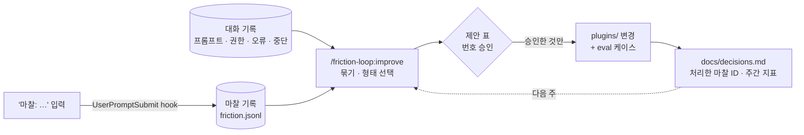

# plugin-playground

쓰면 쓸수록 나아지는 개인용 Claude Code 확장 시스템을 키우는 저장소다. Claude Code 플러그인 마켓플레이스 `aumilkyeong`이면서, 그 시스템을 설계하는 문서를 함께 둔다.

**상태 (2026-11-15):** `friction-loop` 0.1.0 · 시작 단계(첫 주간 검토 전) · Claude Code 2.1.311, Python 3.9.6에서 확인

```bash
claude plugin marketplace add aumilkyeong/plugin-playground
claude plugin install friction-loop@aumilkyeong
```

- 불편한 순간에 `마찰: <무엇이 불편했나>`를 입력하면 기록된다. Claude에게 가지 않아 토큰이 들지 않는다.
- 일주일에 한 번 `/friction-loop:improve`를 실행하면 마찰 기록과 최근 대화를 묶어 개선안을 표로 제안한다.
- 승인한 번호만 플러그인에 반영되고, 재현용 eval 케이스와 결정 기록이 함께 남는다.

## 목표와 원칙

장기 목표는 **직관적이고 강력한 개인용 자가개선 시스템**이다.

- **직관적:** 사용자가 할 일은 기록 한 줄과 승인 한 번뿐이다. 찾고 묶고 제안하는 일은 시스템이 하고, 기록하지 않은 마찰도 대화 기록에서 찾아낸다.
- **강력한:** skill, hook, agent, rule 등 어떤 형태의 확장이든 만들고 고치고 지울 수 있고, 모든 변경은 eval로 검증한다.
- **자가개선:** 이 시스템의 본체는 부품이 아니라 개선 루프다. 다음에 무엇을 만들지는 루프에 쌓인 기록이 정한다.

설계할 때 지키는 원칙은 세 가지다.

1. **기록 한 줄, 승인 한 번.** 사용자에게 요구하는 일을 늘리는 변경은 다시 생각한다.
2. **자동은 제안까지, 반영은 승인.** hook과 스크립트는 샌드박스 밖에서 사용자 권한으로 돌기 때문에, 시스템이 스스로를 고칠 때는 항상 승인을 거친다.
3. **더할 때 지울 길도 같이.** 확장이 늘어도 매 턴 상시로 실리는 컨텍스트 비용은 늘지 않게 한다.

## 작동 방식



| 단계 | 하는 일 | 담당 |
|---|---|---|
| 포착 | `마찰:`로 시작하는 프롬프트를 기록하고 막는다 | `hooks/hooks.json`, `scripts/friction.py` |
| 수집 | 열린 마찰, 최근 N일 직접 입력한 프롬프트, 사용자가 말하지 않은 신호(권한 확인·거절, 도구 오류, 중단)를 모은다 | `scripts/friction.py`, `scripts/recent_prompts.py`, `scripts/recent_signals.py` |
| 제안 | 원인이 같은 것끼리 묶고 만들기·고치기·승격·지우기 중 하나와 담을 형태를 고른다 | `skills/improve/SKILL.md` |
| 반영 | 승인한 번호만 `plugins/`에 반영하고 eval 케이스를 더한다 | `/friction-loop:improve` |
| 기록 | 처리한 마찰 ID와 주간 지표를 남긴다. ID가 적힌 마찰은 다음 검토에서 빠진다 | `docs/decisions.md` |

담당 파일은 모두 `plugins/friction-loop/` 아래에 있다. 북극성 지표는 **반복 지시**, 즉 같은 지시를 여러 세션에서 되풀이한 묶음의 수다. 줄어들수록 시스템이 나아지고 있다는 뜻이다.

## 빠른 시작

필요한 것: Claude Code(2.1.311에서 확인), Python 3.9 이상, macOS 또는 Linux. 기록 스크립트가 `fcntl`을 쓰므로 네이티브 Windows에서는 돌지 않는다.

### 1. 설치하기

```bash
claude plugin marketplace add aumilkyeong/plugin-playground   # 처음 한 번
claude plugin install friction-loop@aumilkyeong
```

어느 프로젝트에서든 `마찰: 테스트`를 입력해 본다. `마찰 F-001 기록 · 누적 1건 · 검토는 /friction-loop:improve`가 담긴 메시지가 보이면 된다. 이 메시지는 Claude에게 전달되지 않는다.

개인 마켓플레이스는 자동 업데이트가 기본으로 꺼져 있다. 새 버전은 `claude plugin update friction-loop@aumilkyeong`으로 받거나, `/plugin`의 Marketplaces 탭에서 자동 업데이트를 켠다.

### 2. 주간 검토까지 쓰기

`/friction-loop:improve`는 확장을 담은 저장소의 `plugins/`를 고치면서 시스템을 키운다. 그래서 고칠 사본이 있어야 돈다. 이 저장소를 포크해서 내려받는다.

```bash
git clone https://github.com/<내 계정>/plugin-playground.git
cd plugin-playground
```

`.claude-plugin/marketplace.json`의 `"name"`을 내 이름(예: GitHub 계정)으로 바꾸고, 내 사본을 마켓플레이스로 등록해 설치한다.

```bash
claude plugin marketplace add "$PWD"
claude plugin install friction-loop@<내 이름>
```

로컬 경로로 등록한 마켓플레이스의 상대 경로 플러그인은 캐시로 복사되지 않고 제자리에서 로드된다. 그래서 사본을 고친 뒤에는 세션에서 `/reload-plugins`만 실행하면 반영된다.

1단계에서 원본을 설치했다면 같은 이름의 플러그인이 둘이 되므로 원본을 지운다. 원본 설치본의 마찰 기록을 옮기려면 `claude plugin uninstall friction-loop@aumilkyeong --keep-data`로 지운 뒤, `~/.claude/plugins/data/` 아래 원본 플러그인 폴더의 `friction.jsonl`을 새 설치본 폴더로 복사한다.

일주일쯤 마찰을 모은 뒤 사본 폴더에서 Claude Code를 열고 실행한다. 다른 폴더에서 부르면 아무것도 하지 않고 사본으로 옮기라고 안내한다.

```text
/friction-loop:improve        # 최근 7일
/friction-loop:improve 14     # 최근 14일
```

### 3. 설치 없이 고쳐 보기

플러그인을 고치는 중에는 설치하지 않고 이 세션에만 불러온다. 저장소 루트에서 실행한다.

```bash
claude --plugin-dir ./plugins/friction-loop
```

## 저장소 구조

```text
plugin-playground/
├── .claude-plugin/marketplace.json   # 마켓플레이스 'aumilkyeong' 카탈로그
├── plugins/
│   └── friction-loop/                # 자가개선 루프 플러그인 → plugins/friction-loop/README.md
│       ├── .claude-plugin/plugin.json
│       ├── hooks/hooks.json          # 마찰 포착 hook
│       ├── scripts/                  # friction.py(기록·조회), recent_prompts.py·recent_signals.py(대화 기록 수집)
│       ├── skills/improve/SKILL.md   # /friction-loop:improve 주간 검토
│       └── evals/                    # 변경마다 재현 케이스가 쌓인다
├── docs/
│   └── decisions.md                  # 형태 선택 기준, 주간 지표, 변경 기록
└── LICENSE
```

## 플러그인

| 플러그인 | 버전 | 하는 일 | 구성 요소 |
|---|---|---|---|
| [`friction-loop`](plugins/friction-loop/README.md) | 0.2.0 | 마찰 포착과 주간 자가개선 검토 | hook 1, skill 1, 스크립트 3, eval 케이스 2 |

## 문서

- [결정 기록](docs/decisions.md): 어떤 요구를 어떤 형태에 담는지, 무엇을 왜 바꿨는지, 주간 지표

## 지금 다루는 범위

`friction-loop` 0.2.0은 자가개선 시스템에 필요한 여러 역량을 얇게 관통하는 첫 조각이다.

| 역량 | 0.2.0에서 하는 일 |
|---|---|
| 확장 형태 선택 | `docs/decisions.md`의 형태 선택 기준표 |
| Skill 설계 | 직접 부를 때만 도는 `/friction-loop:improve` |
| 수명주기 훅 | `UserPromptSubmit` 마찰 포착 |
| 매니페스트, 개인 마켓플레이스 | `plugin.json`, 마켓플레이스 `aumilkyeong` |
| 개발 루프, 정적 검증 | `--plugin-dir`, `validate --strict` 통과 |
| 행동 평가 | eval 케이스 2개(저장소 밖 실행 차단, 기록하지 않은 마찰 찾기) |
| 마찰 수집과 개선 루프 | 포착(직접 기록) + 수집(대화 기록의 프롬프트와 신호) → 검토 → 반영 → 기록 |

다음 순서는 다음과 같다.

1. **루프 한 바퀴:** 마찰을 10건쯤 모으고, 첫 `/friction-loop:improve`로 변경 2~3건을 eval과 함께 반영한다.
2. **운영 체계:** git 태그로 릴리스하고, 샌드박스와 서드파티 플러그인을 점검한다.
3. **품질과 측정:** CI에서 validate와 eval을 돌리고, `/skill-doctor`로 사용 진단을 주기적으로 한다.

## 바꾸는 방법

기본 경로는 `/friction-loop:improve`다. 직접 고칠 때도 같은 규칙을 따른다.

1. 담을 형태는 `docs/decisions.md`의 형태 선택 기준을 따른다. 판단이 갈리면 약한 형태로 시작한다.
2. 변경마다 그 문제를 재현하는 eval 케이스를 해당 플러그인의 `evals/`에 더한다. 형식은 [`plugins/friction-loop/evals/README.md`](plugins/friction-loop/evals/README.md)에 있다.
3. `plugin.json`의 `version`을 올린다. 새 확장은 minor, 수정과 삭제는 patch. 마켓플레이스에서 설치한 사람은 이 값이 바뀌어야 업데이트를 받는다.
4. 검증을 통과시킨다.
5. `docs/decisions.md`의 변경 기록에 한 줄 남긴다. 처리한 마찰 ID가 있으면 함께 적는다.

```bash
claude plugin validate --strict plugins/friction-loop   # 플러그인
claude plugin validate --strict .                       # 마켓플레이스
cd plugins/friction-loop && claude plugin eval . --scaffold --allow-tools "Bash(python3 *)" --max-cost-usd 2   # 실제 모델을 부르므로 비용이 든다
```

새 플러그인은 `plugins/<이름>/`에 만들고 `.claude-plugin/marketplace.json`의 `plugins` 배열에 항목을 더한다.

## 데이터와 개인정보

| 데이터 | 위치 | 다루는 방식 |
|---|---|---|
| 마찰 기록 | `~/.claude/plugins/data/<플러그인 ID>/friction.jsonl` | hook이 쓰고 `/friction-loop:improve`가 읽는다. 플러그인을 업데이트해도 남는다 |
| 대화 기록 | `~/.claude/projects/<프로젝트>/*.jsonl` | `recent_prompts.py`와 `recent_signals.py`가 읽기만 한다. Claude Code 설정 `cleanupPeriodDays`(기본 30일)가 지나면 지워진다 |
| 결정 기록 | `docs/decisions.md` | `/friction-loop:improve`가 쓰고 git으로 관리한다 |

- 마찰 기록과 대화 기록은 저장소에 들어오지 않는다.
- 스크립트는 네트워크를 쓰지 않는다. 다만 `/friction-loop:improve`를 실행하면 마찰 내용, 프롬프트 발췌, 실패하거나 거절된 명령의 발췌가 세션 컨텍스트에 들어가 모델로 전달된다.

## 알려진 제약

- `--plugin-dir`로 띄운 개발본과 설치본은 플러그인 ID가 달라 마찰 기록이 서로 다른 폴더에 쌓일 수 있다. 실제 기록은 설치본으로 쌓는다.
- 2026-11-15 기준으로 hook과 스크립트는 단위 테스트만 거쳤다. 실제 세션에서의 hook 동작과 eval 실행은 아직 확인하지 않았다.
- `claude plugin eval`은 early access 기능이고 실행할 때마다 비용이 든다.
- 샌드박스가 켜진 Claude Code 세션에서는 Bash의 `.git` 쓰기(`git commit` 등)가 막힐 수 있다. 승인을 받아 샌드박스 밖에서 실행하거나 터미널에서 직접 실행한다.

## 라이선스

[MIT](LICENSE)

## 참고

- [Plugins overview](https://code.claude.com/docs/en/plugins/overview) · [Plugin loading reference](https://code.claude.com/docs/en/plugins/loading) · [Hooks reference](https://code.claude.com/docs/en/hooks) · [Skills](https://code.claude.com/docs/en/skills) · [Plugin evals](https://code.claude.com/docs/en/plugin-evals)
