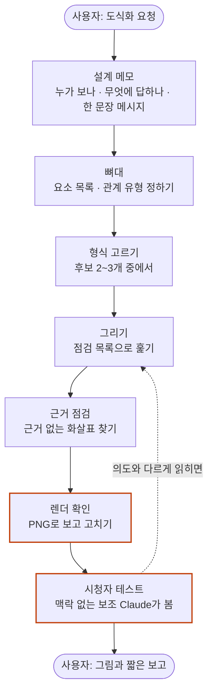

# visualize-idea: 아이디어 도식화

Claude가 아이디어, 구조, 과정을 도식(다이어그램)으로 그릴 때, 내용의 관계에 맞는 형식을 고르고 실제로 그려진 그림을 확인한 뒤에 내놓게 하는 플러그인이다. 설치해 두면 도식화를 부탁하거나 Claude가 문서에 구조도나 흐름도를 넣을 때 skill(Claude가 필요할 때 꺼내 읽는 작업 지침)이 저절로 발동한다. 평소 채팅 답변에서는 그림을 부탁할 때만 발동한다. 직접 부르려면 `/visualize-idea:visualize <요청>`을 입력한다.

```bash
claude plugin marketplace add aumilkyeong/plugin-playground   # 처음 한 번, 마켓플레이스 'aumilkyeong' 등록
claude plugin install visualize-idea@aumilkyeong
```

필요한 것: Python 3.9 이상(추가 패키지 없음), macOS 또는 Linux. Claude가 그린 그림을 이미지로 확인하려면 Chrome 계열 브라우저(Chrome, Chromium, Edge, Brave)도 있어야 한다. 브라우저가 없어도 그림은 그리지만, 이미지 확인은 건너뛴다. Claude Code의 샌드박스를 켜 두었다면 [렌더 확인 준비](#렌더-확인-준비)를 읽어 둔다.

이 플러그인이 막으려는 실수는 넷이다. 부품을 상자로 늘어놓고 무엇이 어디를 거쳐 어디로 가는지를 빠뜨린다. 내용과 상관없이 늘 쓰던 형식(흐름도)을 고른다. 근거 없는 인과 화살표를 그린다. 그리고 그려진 결과를 보지 않고 코드만 보고 끝낸다. 그래서 그리기 전에 요소 사이의 관계 유형부터 정하고, 다 그리면 그림을 렌더(코드를 실제 그림으로 그려 내는 일)해 PNG 이미지로 직접 본다. 무거운 그림은 대화 맥락이 없는 `cold-viewer` agent(대화 내용을 넘겨받지 않고 따로 도는 보조 Claude)에게 그림만 보여 주고, 메시지가 그대로 읽히는지 시험한다.

## 그리기 전에 뼈대를 정하고, 그린 뒤에 확인한다



모든 단계는 Claude가 하고, 사용자는 요청하고 결과를 받는다. 테두리를 강조한 두 단계는 그려진 결과를 확인하는 단계다. 그림이 가벼우면 단계를 건너뛴다.

| 무게 | 예 | 거치는 단계 |
|---|---|---|
| 가벼움 | 채팅 답변 속 짧은 도식 | 설계 메모(속으로), 그리기, 근거 점검, 렌더 확인(텍스트 도식은 폭 검사만) |
| 보통 | 문서나 README 속 도식 | 시청자 테스트를 뺀 전부 |
| 무거움 | 따로 볼 그림, 남이 보고 판단할 그림 | 전부 |

## 매체는 그림이 놓일 곳으로 고른다

| 그림이 놓일 곳 | 매체 |
|---|---|
| 저장소 문서(README, `docs/*.md`) 안 | Mermaid(글로 쓰는 다이어그램 문법. GitHub에서 그림으로 보인다) |
| 따로 열어 볼 그림 | SVG 파일(브라우저에서 열리는 벡터 그림) |
| 채팅 답변 속 | 터미널 텍스트 도식 |
| 아티팩트(Claude가 claude.ai에 게시하는 웹 페이지) | 페이지 안의 SVG 또는 Mermaid |

매체를 직접 정하면 그것을 따른다. 움직이는 그림(animated SVG)은 부탁할 때만 만든다.

## 렌더 확인 준비

`scripts/render.py`가 Chrome 계열 브라우저를 화면 없이 띄워 그림을 PNG로 만든다. Mermaid 그림은 cdn.jsdelivr.net에서 Mermaid를 불러와 그리므로 인터넷 연결이 필요하다.

브라우저는 Claude Code의 샌드박스(Claude가 실행하는 명령이 건드릴 수 있는 파일과 네트워크를 제한하는 기능) 안에서 뜨지 않는다. 그래서 샌드박스가 켜져 있으면 이 명령은 샌드박스 밖에서 실행해야 한다. 샌드박스가 켜져 있는지는 Claude Code에서 `/sandbox`를 입력하면 보인다. 꺼져 있으면 이 절은 건너뛴다.

켜져 있다면 사용자 설정 파일 `~/.claude/settings.json`에 이 명령만 샌드박스 밖에서 돌게 예외를 더해 둘 수 있다. 파일에 이미 `sandbox` 항목이 있으면 그 안의 `excludedCommands` 목록에 한 줄만 더한다.

```json
{
  "sandbox": {
    "excludedCommands": ["python3 *visualize-idea*render.py*"]
  }
}
```

예외는 명령 전체가 패턴과 맞을 때만 적용된다. 그래서 skill은 렌더 명령을 다른 명령과 묶지 않고 단독으로 실행한다. 이 예외는 2026-11-16에 이 저장소 주인의 macOS 환경에서 실제로 적용되는 것을 확인했다.

예외는 꼭 필요하지 않다. 예외를 두면 이 명령은 다른 명령과 같은 평소 권한 규칙으로 실행된다. 예외가 없으면 Claude가 렌더할 때마다 샌드박스 밖 실행을 따로 승인받아야 하고, 승인하지 않으면 그 그림의 렌더 확인과 시청자 테스트를 건너뛴 채 건너뛰었다고 알린다. 브라우저가 없을 때도 같다.

브라우저는 macOS에서는 `/Applications`의 Chrome, Chromium, Edge, Brave를, Linux에서는 `PATH`의 `google-chrome`, `chromium`을 찾는다. 다른 곳에 있으면 환경 변수 `VISUALIZE_BROWSER`에 실행 파일 경로를 넣는다. Windows에서는 시험하지 않았다.

여기부터는 플러그인이 어떻게 생겼는지 알고 싶거나 고치려는 사람을 위한 내용이다.

## 파일마다 하는 일

| 파일 | 역할 |
|---|---|
| `skills/visualize/SKILL.md` | 그리는 절차. 도식화를 부탁하거나 밖으로 나가는 글에 도식이 필요할 때 발동한다 |
| `skills/visualize/references/forms.md` | 관계 유형별 형식, 형식이 하는 주장(나무는 "부모가 하나"), 그림을 문장으로 다시 읽는 표 |
| `skills/visualize/references/craft.md` | 강조, 시각 변수, 묶음, 색, 배치, 선과 화살표, 글 점검 목록 |
| `skills/visualize/references/media.md` | 매체 고르기, Mermaid·SVG·아티팩트·터미널 텍스트 도식 그리는 법, 렌더 방법 |
| `skills/visualize/references/standards.md` | 개인 기준. 이 저장소 주인에게 지적받은 실패와 해법 |
| `agents/cold-viewer.md` | 시청자 테스트. 렌더한 그림만 보고, 쓸 수 있는 도구는 Read뿐이다 |
| `scripts/render.py` | SVG, HTML, Mermaid를 PNG로 렌더한다. Mermaid 문법 오류도 잡는다 |
| `scripts/textwidth.py` | 터미널 텍스트 도식에서 상자 테두리가 맞는지 검사한다. 한글은 터미널에서 2칸을 차지해서, 글자 수로 맞추면 테두리가 어긋난다 |
| `evals/` | 흐름도, 가설과 상관을 구분해 그리기, 터미널 상자 도식, 단순한 질문에는 발동하지 않음을 확인하는 케이스 |

## 개인 기준은 friction-loop가 키운다

`standards.md`에는 이 저장소 주인의 기준 세 가지가 들어 있다. 따로 말이 없으면 초보자가 보는 그림으로 그리고, 레이블은 한국어로 쓰고, 품질 기준을 따로 시키지 않아도 적용한다. 그대로 설치하면 이 기준도 함께 적용된다. 항목은 대화 기록에서 되풀이된 지시를 근거로 했다. 예를 들어 초보자 기준은 도식을 초보자 눈높이로 다듬어 달라는 요청이 2번 나와서 넣었다.

같은 저장소의 [friction-loop](../friction-loop/README.md) 플러그인(불편했던 순간을 모아 확장을 고치자고 제안하는 플러그인)을 함께 쓰면, 도식을 고치라고 한 말이 쌓일 때 `/friction-loop:improve`가 이 목록에 항목을 더하거나 지우자고 제안한다. visualize-idea만 쓸 때는 friction-loop가 없어도 된다.

기준을 바꾸려면 이 저장소를 포크해서 `standards.md`의 항목을 자기 기준으로 고친 뒤, 포크한 사본에서 설치한다.

## 절차의 근거

절차와 점검 항목은 시각화 전문가 역량지도(10개 영역, 40개 역량)를 바탕으로 했다. 파일 곳곳의 괄호 번호(예: 2.2)가 그 역량 번호다. 역량지도는 개인 조사 문서라 저장소에 넣지 않았다.

## 확인한 범위

`render.py`는 macOS의 Chrome으로 SVG, Mermaid, CSS로 움직이는 SVG(끝 장면, 움직임을 끈 장면, 어두운 화면)를 렌더해 확인했다. Linux, Chrome 밖의 브라우저, SVG 자체 애니메이션 문법(SMIL)은 확인하지 않았다. eval(실제 모델에 같은 상황을 시켜 보고 채점하는 시험)은 렌더와 시청자 테스트를 보지 않는다. eval이 도는 격리 환경 안에서는 브라우저가 뜨지 않기 때문이다.

## 설치 없이 고쳐 보기

설치하지 않고 이 세션에만 불러온다. 저장소 루트에서 실행한다.

```bash
claude --plugin-dir ./plugins/visualize-idea
```

스크립트는 따로 실행해 볼 수 있다.

```bash
python3 plugins/visualize-idea/scripts/render.py 그림.svg         # PNG 경로를 출력한다
python3 plugins/visualize-idea/scripts/textwidth.py 도식.txt      # 어긋난 테두리를 알려 준다
```

eval 실행 방법은 [`evals/README.md`](evals/README.md)에 있다.
